<p align="center">
  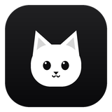
</p>

<h1 align="center">NotchZero</h1>

<p align="center">
  A little Dynamic Island for your Mac's notch and your Windows PC.<br>
  Music, prayer times, system stats, and a mascot that dances to your music.
</p>

<p align="center">
  <a href="../../releases/latest/download/NotchZero-Setup.exe"><b>⬇ Download for Windows</b></a>
  &nbsp;·&nbsp;
  <a href="../../releases/latest/download/NotchZero-macOS.dmg"><b>⬇ Download for macOS</b></a>
  &nbsp;·&nbsp;
  <a href="../../releases/latest">All downloads</a>
</p>

<p align="center">
  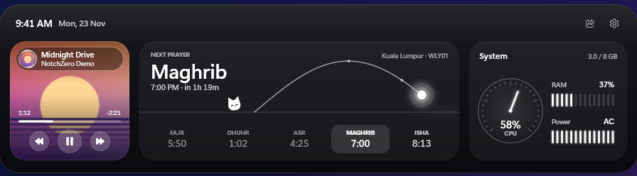
</p>

## What it does

NotchZero sits at the top centre of your screen: in the notch on a MacBook, and as a small black pill on Windows.

| | |
|---|---|
| 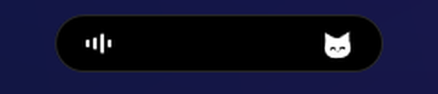 | **While music plays**, white bars bounce on the left and the mascot dances on the right. |
| 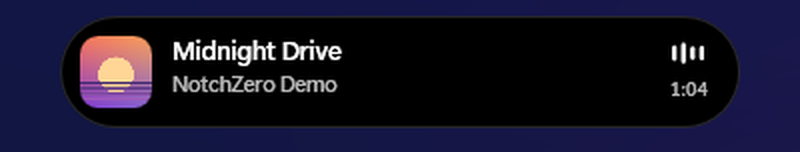 | **When a new song starts**, the island peeks out for a few seconds with the artwork and title. |
| 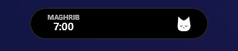 | **The next prayer** and a countdown when it's close. At prayer time you get a quiet notification (no azan) and your music pauses for a few seconds, then carries on. |

**Hover the island** (or click it) to open the full panel:

- **Music**: Spotify, Apple Music, YouTube in your browser, and most other players. Play, pause, skip and seek.
- **Prayer times**: today's five JAKIM times for your zone, with the sun (or moon) moving across the sky. The zone is picked from your location (on Windows you can also choose it yourself). Kuala Lumpur (WLY01) is the default.
- **System**: CPU on a dial, RAM and battery as glowing bars.
- **Share files**: drop files on the island to share them, with AirDrop on a Mac and the Windows Share sheet on a PC.

### Mascots

Pick one in **Settings → Mascot**. They blink, dance while music plays, doze off when you're away, and sit on a sejadah at prayer time.

<p align="center">
  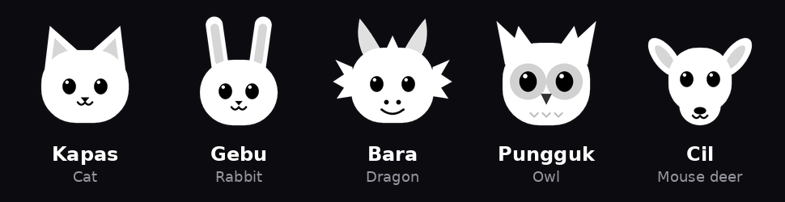
</p>

---

## Install on Windows

Works on **Windows 10 and 11** (64-bit). No admin rights needed.

**1. Download** [`NotchZero-Setup.exe`](../../releases/latest/download/NotchZero-Setup.exe) and open it.

**2. Windows shows a blue "Windows protected your PC" box.** That's because NotchZero isn't signed with a paid certificate, not because anything is wrong. Click **More info**, then **Run anyway**.

<p align="center">
  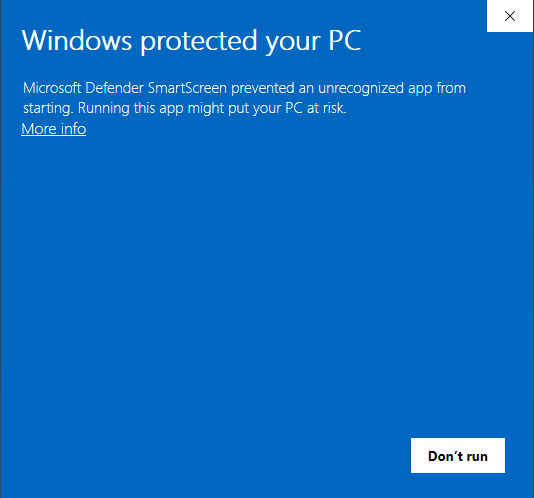
  &nbsp;
  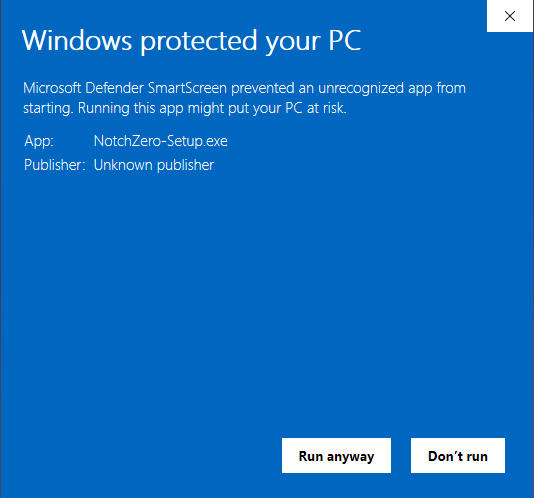
</p>

**3. Click Install, then Finish.** "Start NotchZero when Windows starts" is ticked by default. Untick it on the first page if you'd rather start it yourself.

<p align="center">
  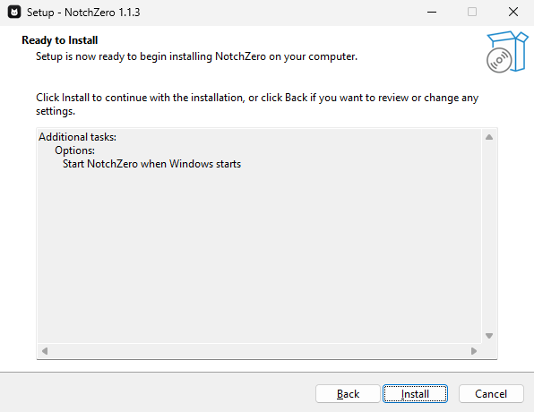
  &nbsp;
  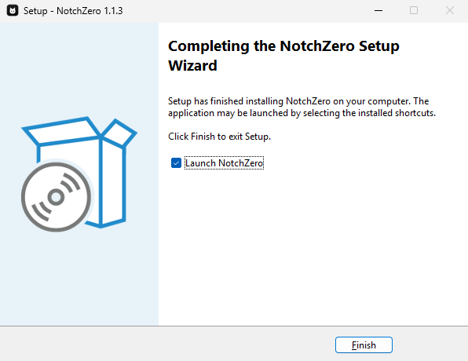
</p>

**4. Look at the top centre of your screen** and hover the little pill to open NotchZero.

<p align="center">
  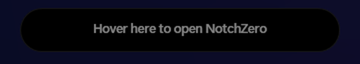
</p>

**5. Windows may ask about your location.** Choose **Yes** so NotchZero can pick your prayer zone automatically, or **No** and choose your zone in **Settings → Choose Prayer Zone**.

<p align="center">
  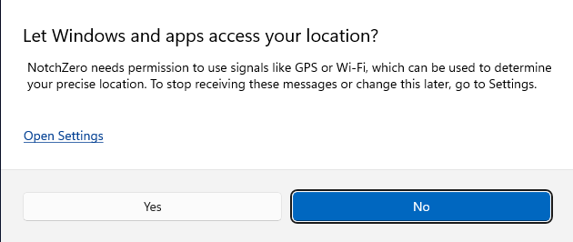
</p>

**Tips for Windows**

- The island stays slim when nothing is happening, so it doesn't cover your browser tabs. Turn on **Settings → Show Mascot When Idle** to always see the mascot and the next prayer.
- It hides itself during full-screen videos, games and presentations.
- Settings are behind the gear in the panel, or right-click the NotchZero icon in the taskbar tray.
- To uninstall: **Settings → Apps → Installed apps → NotchZero → Uninstall**.

---

## Install on macOS

Needs **macOS 26 Tahoe or later**, on Apple silicon or Intel. Best on a MacBook with a notch; on other Macs it sits at the top centre of the screen.

**1. Download** [`NotchZero-macOS.dmg`](../../releases/latest/download/NotchZero-macOS.dmg), open it, and drag **NotchZero** into **Applications**.

<p align="center">
  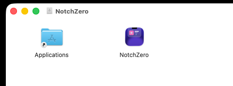
</p>

**2. Open NotchZero from Applications.** The first time, macOS says it can't check the app, because NotchZero isn't notarized by Apple. Click **Done**, then:

- Open **System Settings → Privacy & Security**.
- Scroll down to the message about NotchZero and click **Open Anyway**.
- Confirm with your password or Touch ID.

You only need to do this once. If you prefer Terminal, this does the same thing:

```sh
xattr -dr com.apple.quarantine /Applications/NotchZero.app
```

**3. Allow what it asks for.** NotchZero asks to control **Spotify** or **Music** (to show and control what's playing) and for your **location** (to pick the prayer zone). Both are optional.

**4. Hover the notch** to open the panel.

<p align="center">
  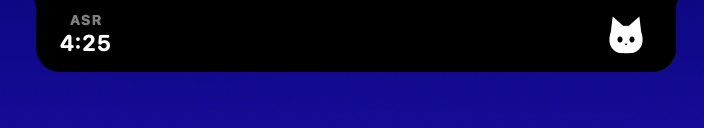
</p>
<p align="center">
  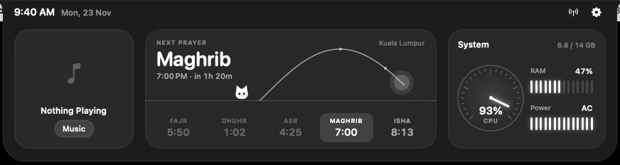
</p>

**Tips for macOS**

- The gear in the panel has the style (Liquid Glass, Frosted Glass or Solid Black), the mascot, the song peek, prayer times and Launch at Login.
- Drop files on the notch to send them with AirDrop.

---

## Privacy

NotchZero has no account and no tracking. It only goes online for prayer times, from [api.waktusolat.app](https://api.waktusolat.app) (JAKIM data), with JAKIM e-Solat as the fallback. If you allow location, your coordinates are sent to that API only to find your JAKIM zone. Settings and a small log stay on your computer.

## Build it yourself

- **Windows**: .NET 8 SDK on Windows, then
  `dotnet publish windows/NotchZero.csproj -c Release -r win-x64 --self-contained true -p:PublishSingleFile=true -p:IncludeNativeLibrariesForSelfExtract=true -o publish`
- **macOS**: Xcode 26, then double-click `macos/build.command`, or open `macos/NotchZero.xcodeproj`.

Every push to `main` builds both apps with GitHub Actions and publishes a new release.

## Credits

Prayer times: JAKIM e-Solat, via the [waktusolat.app](https://waktusolat.app) API.
